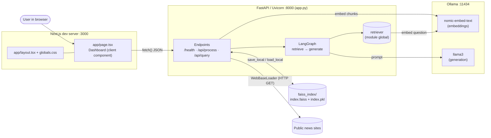
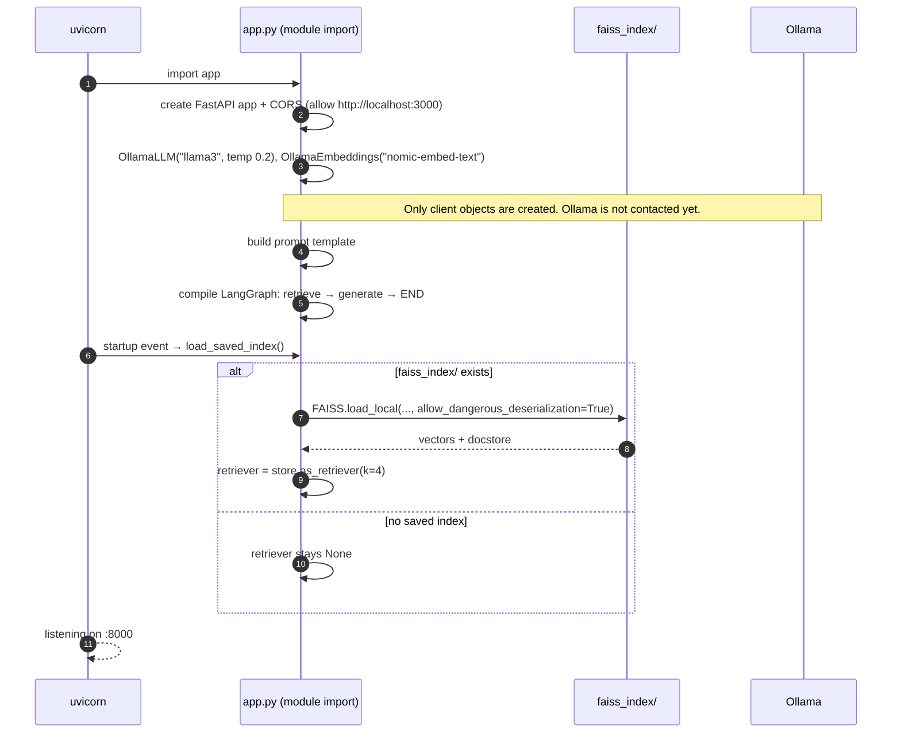
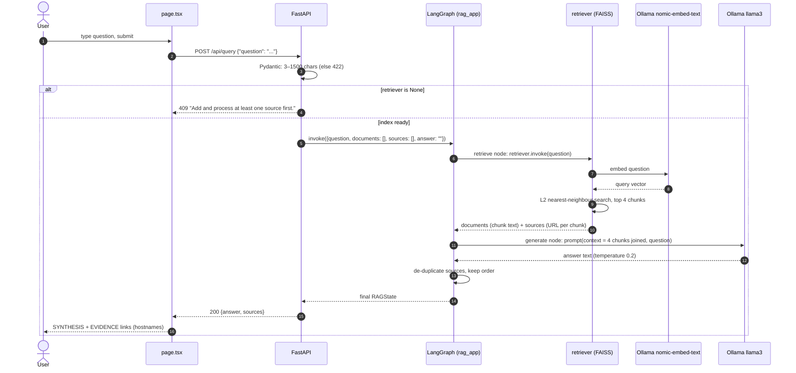
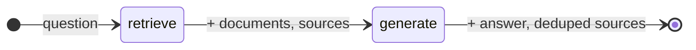
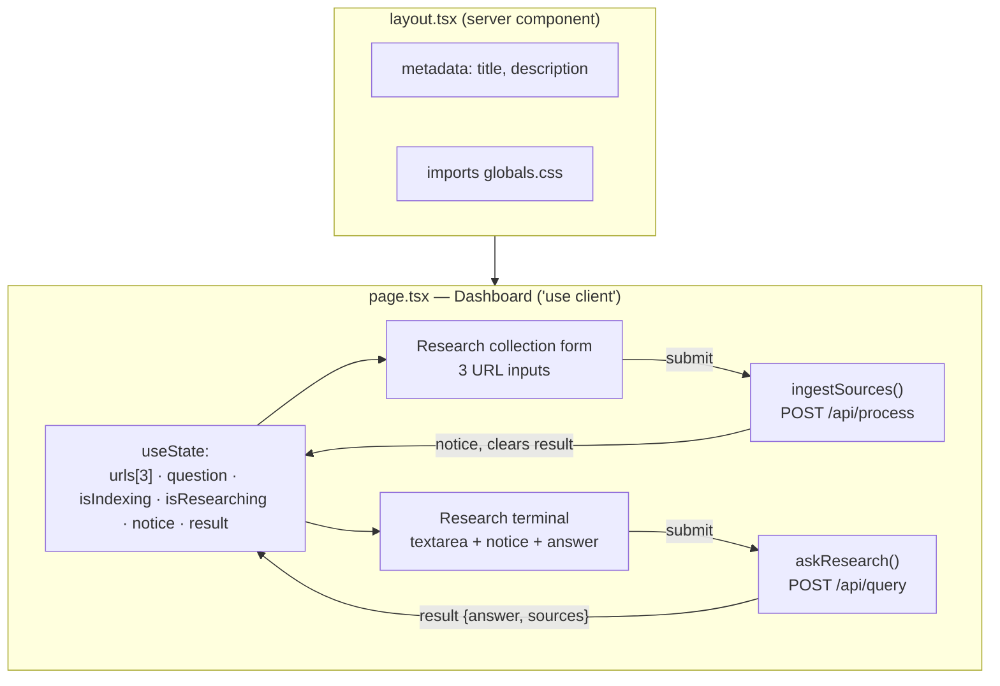
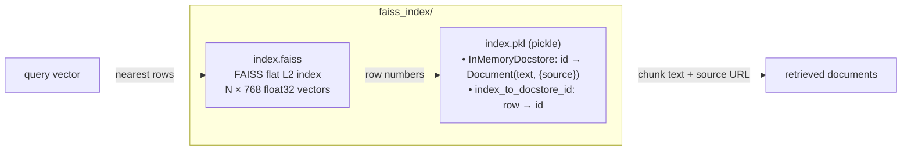
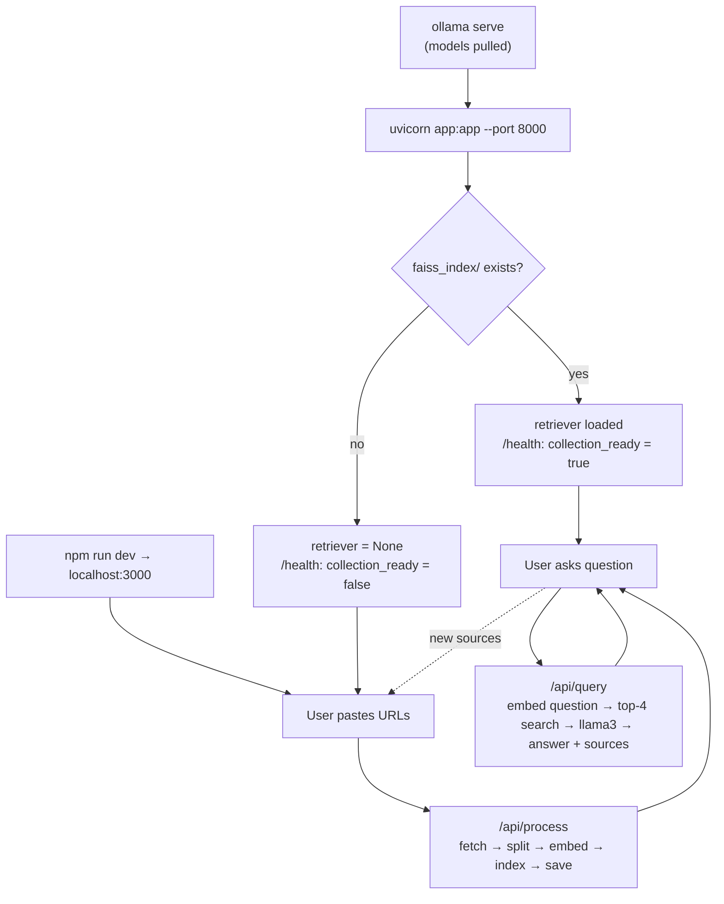

# FinSight — Architecture

How FinSight works internally, from the browser click down to the vectors on disk. The diagrams are [Mermaid](https://mermaid.js.org/) and render on GitHub and in VS Code (with a Mermaid preview extension).

---

## 1. System overview

FinSight is three local processes talking over HTTP on `localhost`. Nothing leaves your machine except the one-time fetch of the article URLs you supply.



| Layer | Technology | Lives in | Role |
|---|---|---|---|
| UI | Next.js 15 (App Router), React 19, TypeScript | `app/` | Collects URLs and questions, shows answers and sources |
| API | FastAPI + Uvicorn, Pydantic | `app.py` | Validates requests, runs ingestion and the RAG graph |
| Orchestration | LangChain, LangGraph | `app.py` | Loader, splitter, prompt, `retrieve → generate` state machine |
| Vector store | FAISS (`faiss-cpu`) | memory + `faiss_index/` | Similarity search over chunk embeddings |
| Models | Ollama (`nomic-embed-text`, `llama3`) | separate Ollama service | Embeddings and answer generation |

---

## 2. Startup sequence



Key points:

- **Everything is module-level.** `llm`, `embeddings`, `prompt`, `rag_app` (the compiled graph) and `retriever` are created once per process and shared by all requests.
- **`retriever` is the only mutable state.** It is `None` until an index is loaded or built. Both endpoints read it, and `/api/process` replaces it.
- **`INDEX_PATH = Path("faiss_index")` is relative**, so Uvicorn must be started from the repo root or the saved index won't be found.
- **`index.pkl` is a pickle**, which is why loading needs `allow_dangerous_deserialization=True`. Only load indexes you created yourself.

---

## 3. Flow A — building a research collection (`POST /api/process`)

### 3.1 Request path

```mermaid
sequenceDiagram
    autonumber
    actor User
    participant P as page.tsx
    participant F as FastAPI
    participant W as News sites
    participant S as Text splitter
    participant O as Ollama (nomic-embed-text)
    participant X as FAISS
    participant D as faiss_index/

    User->>P: paste 1–3 URLs, click "Create research collection"
    P->>P: trim, drop empty fields; if none → notice, stop
    P->>F: POST /api/process {"urls": [...]}
    Note over P,F: Browser sends a CORS preflight (OPTIONS) first
    F->>F: Pydantic: 1–10 items, each a valid HttpUrl (else 422)
    F->>W: WebBaseLoader GET each URL
    W-->>F: HTML → BeautifulSoup → plain text Documents (metadata.source = URL)
    F->>S: split_documents (1000 chars, 200 overlap)
    S-->>F: chunks
    F->>O: embed every chunk
    O-->>F: one 768-dim vector per chunk
    F->>X: FAISS.from_documents(chunks, embeddings)
    X->>D: save_local → index.faiss + index.pkl (overwrites)
    F->>F: retriever = store.as_retriever(k=4)  (replaces old one)
    F-->>P: 200 {message, indexed_documents, sources}
    P-->>User: "N research passages indexed from M sources."
```

### 3.2 Inside each step

| Step | What happens | Settings |
|---|---|---|
| Validation | `ProcessRequest.urls: List[HttpUrl]`, min 1, max 10. Bad input never reaches the handler; FastAPI returns 422 with field errors. | URLs are converted back to `str` before loading |
| Loading | `WebBaseLoader(web_paths=tuple(urls)).load()` downloads each page with `requests` and strips HTML with BeautifulSoup. Each page becomes one `Document` whose `metadata["source"]` is its URL. | No JavaScript rendering, so JS-only or paywalled pages may yield little text. Logs warn that `USER_AGENT` is unset. |
| Splitting | `RecursiveCharacterTextSplitter` tries separators in order `"\n\n"`, `"\n"`, `"."`, `","` and keeps chunks ≤ 1000 characters. | 200-character overlap keeps sentences that cross a boundary retrievable. Each chunk inherits its page's `source`. |
| Embedding | `OllamaEmbeddings` sends chunk text to Ollama's embedding API; `nomic-embed-text` returns a vector per chunk. | Runs on your CPU/GPU via Ollama; this is usually the slowest step. |
| Indexing | `FAISS.from_documents` stores vectors in a flat (exact, brute-force) L2 index, and chunk text + metadata in an in-memory docstore keyed by ID. | Flat search is exact and fine for the few hundred chunks a handful of articles produce. |
| Persisting | `save_local("faiss_index")` writes `index.faiss` (the vectors) and `index.pkl` (docstore + ID mapping). | **Overwrites** the previous collection. There is no append. |
| Activation | The global `retriever` is swapped to the new store with `k=4`. | Takes effect for the very next query. |

Any exception in this handler (network failure, empty page, Ollama down) is returned as **422** `"Could not process URLs: …"`, and the old index stays in place on disk unless saving had already happened.

---

## 4. Flow B — asking a question (`POST /api/query`)

### 4.1 Request path



### 4.2 The LangGraph state machine



The graph state is a `TypedDict`:

```python
class RAGState(TypedDict):
    question: str        # set by the endpoint
    documents: List[str] # filled by retrieve: page_content of top-4 chunks
    sources: List[str]   # filled by retrieve: metadata["source"] per chunk
    answer: str          # filled by generate
```

Each node receives the full state and returns a new full state (`{**state, ...}`).

- **`retrieve`** raises if `retriever` is `None` (a second guard behind the endpoint's 409 check), then runs the similarity search.
- **`generate`** builds the chain `prompt | llm | StrOutputParser()`, fills `{context}` with the four chunks separated by blank lines, and stores the plain-text answer. `dict.fromkeys(...)` removes duplicate URLs while keeping their order, because several of the top chunks often come from the same article.

The graph is linear today, but because it's a LangGraph `StateGraph`, adding steps (query rewriting, re-ranking, a "no answer" branch, tool calls) means adding nodes and edges rather than rewriting the endpoint.

### 4.3 The prompt

```
You are a precise financial research assistant. Answer only from the supplied
context. If the context does not support an answer, say so clearly. Keep the answer
concise and do not invent market data.

Context:
{context}        ← 4 retrieved chunks (≈ up to 4,000 characters)

Question: {question}

Answer:
```

The model only sees these four chunks, never the full articles, so answer quality depends heavily on retrieval. Errors in the graph (for example Ollama not running) return **500** `"Could not generate research: …"`.

---

## 5. Frontend internals (`app/`)



- **One client component.** All logic is in `Dashboard`; there are no API routes, server actions or shared components. `layout.tsx` only sets metadata and global CSS.
- **API base URL** is `process.env.NEXT_PUBLIC_API_URL`, defaulting to `http://localhost:8000`. The browser calls FastAPI directly, which is why the backend needs CORS for `localhost:3000`.
- **UI state:**
  - `isIndexing` / `isResearching` disable the buttons and change their labels during requests.
  - `notice` is a single status line used for progress, success and error messages; on failure it shows the backend's `detail`.
  - `result` holds the last answer. Sources render as links labelled by hostname (`new URL(source).hostname`, `www.` removed).
- **Static sections** (hero, "On the horizon" roadmap cards, footer) are presentational only.
- The UI shows three URL fields, while the API accepts up to ten.

---

## 6. Data on disk



FAISS itself only stores numbers. LangChain keeps the mapping from each vector row to its chunk text and URL in `index.pkl`; both files are needed to answer a query.

---

## 7. Error handling and status codes

| Situation | Where caught | Status | Message shown in UI |
|---|---|---|---|
| Invalid URL / too many URLs / question too short or long | Pydantic models | 422 | FastAPI validation detail |
| Page fetch fails, page empty, embedding fails | `/api/process` `except` | 422 | `Could not process URLs: …` |
| Query before any collection exists | `/api/query` guard | 409 | `Add and process at least one source first.` |
| Ollama down or generation error | `/api/query` `except` | 500 | `Could not generate research: …` |
| API not running | browser `fetch` throws | — | `Could not reach the research API.` |

`GET /health` returns `{"status": "ok", "collection_ready": <bool>}` for a quick check.

---

## 8. Design trade-offs and limits

- **Single collection.** Each `/api/process` call replaces the index; there are no collections per user or topic.
- **Single-user assumption.** FastAPI runs these sync handlers in a thread pool, and the global `retriever` is swapped without a lock. Fine for one local user, not for a shared server.
- **Blocking generation.** The answer is returned in one piece once `llama3` finishes; there's no streaming.
- **Exact search.** Flat L2 search is accurate and fast at this scale; a large corpus would need an approximate FAISS index (IVF/HNSW).
- **Fixed retrieval.** `k=4`, 1000-character chunks and temperature 0.2 are hard-coded in `app.py`.
- **Prompt-only grounding.** The prompt tells the model to answer only from the context and not invent market data, but nothing enforces it; `llama3` can still add outside knowledge when retrieved chunks are off-topic.
- **Local-only index.** `faiss_index/` is git-ignored, so a fresh clone starts with no collection until URLs are processed.

---

## 9. Supporting pieces (not in the runtime path)

| Path | Purpose |
|---|---|
| `rag.ipynb` | Original prototype of the same pipeline in a notebook. Uses `UnstructuredURLLoader` and `llama3` at temperature 0.9. Not imported by the app. |
| `Presentation/` | College deck (`FinSight_College_Presentation.pptx`), the script that generates it (`generate_deck.py`) and an image. |
| `postcleanup.md` | Record of removed files and known issues. |
| `CLAUDE.md` | Guidance for Claude Code working in this repo. |

---

## 10. Run-time lifecycle summary


