# FinSight — Architecture

How FinSight works internally, from the browser click down to the vectors on disk. The diagrams are [Mermaid](https://mermaid.js.org/) and render on GitHub and in VS Code (with a Mermaid preview extension).

---

## 1. System overview

FinSight is three local processes talking over HTTP on `localhost`. Nothing leaves your machine except the one-time fetch of the article URLs you supply.

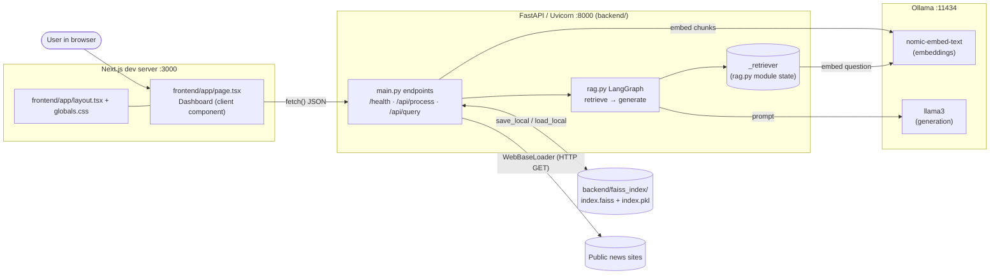

| Layer | Technology | Lives in | Role |
|---|---|---|---|
| UI | Next.js 15 (App Router), React 19, TypeScript | `frontend/app/` | Collects URLs and questions, shows answers and sources |
| API | FastAPI + Uvicorn, Pydantic | `backend/main.py`, `backend/schemas.py` | Validates requests, calls ingestion and the RAG graph |
| Orchestration | LangChain, LangGraph | `backend/rag.py` | Loader, splitter, prompt, `retrieve → generate` state machine |
| Settings | Python constants | `backend/config.py` | Model names, chunking, top-k, index path, CORS |
| Vector store | FAISS (`faiss-cpu`) | memory + `backend/faiss_index/` | Similarity search over chunk embeddings |
| Models | Ollama (`nomic-embed-text`, `llama3`) by default, or Groq (text) + Hugging Face `bge-small-en-v1.5` (embeddings) with `LLM_PROVIDER=groq` | Ollama service, or Groq API + local `sentence-transformers`; built in `backend/llm.py` | Embeddings and answer generation (see §4.7) |

---

## 2. Startup sequence

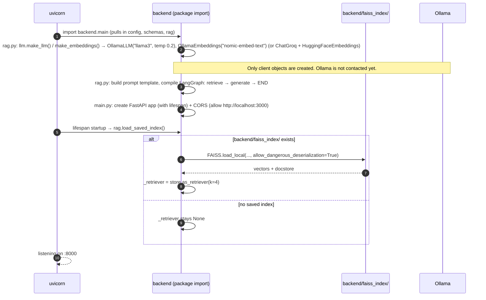

Key points:

- **Everything is module-level in `rag.py`.** `llm`, `embeddings`, `prompt`, `rag_app` (the compiled graph) and `_retriever` are created once per process and shared by all requests.
- **`_retriever` is the only mutable state.** It is `None` until an index is loaded or built. The endpoints reach it only through `rag.is_ready()`, `rag.build_index()` and `rag.answer()`, never by importing it, because `/api/process` replaces it.
- **`INDEX_PATH` is anchored to `backend/config.py`** (`Path(__file__).resolve().parent / "faiss_index"`), so the saved index is found whatever directory Uvicorn is started from.
- **`index.pkl` is a pickle**, which is why loading needs `allow_dangerous_deserialization=True`. Only load indexes you created yourself.

---

## 3. Flow A — building a research collection (`POST /api/process`)

### 3.1 Request path

```mermaid
sequenceDiagram
    autonumber
    actor User
    participant P as page.tsx
    participant F as FastAPI
    participant W as News sites
    participant S as Text splitter
    participant O as Ollama (nomic-embed-text)
    participant X as FAISS
    participant D as backend/faiss_index/

    User->>P: paste 1–3 URLs, click "Create research collection"
    P->>P: trim, drop empty fields; if none → notice, stop
    P->>F: POST /api/process {"urls": [...]}
    Note over P,F: Browser sends a CORS preflight (OPTIONS) first
    F->>F: Pydantic: 1–10 items, each a valid HttpUrl (else 422)
    F->>W: WebBaseLoader GET each URL
    W-->>F: HTML → BeautifulSoup → plain text Documents (metadata.source = URL)
    F->>S: split_documents (1000 chars, 200 overlap)
    S-->>F: chunks
    F->>O: embed every chunk
    O-->>F: one 768-dim vector per chunk
    F->>X: FAISS.from_documents(chunks, embeddings)
    X->>D: save_local → index.faiss + index.pkl (overwrites)
    F->>F: rag._retriever = store.as_retriever(k=4)  (replaces old one)
    F-->>P: 200 {message, indexed_documents, sources}
    P-->>User: "N research passages indexed from M sources."
```

### 3.2 Inside each step

| Step | What happens | Settings |
|---|---|---|
| Validation | `ProcessRequest.urls: List[HttpUrl]`, min 1, max 10. Bad input never reaches the handler; FastAPI returns 422 with field errors. | URLs are converted back to `str` before loading |
| Loading | `WebBaseLoader(web_paths=tuple(urls)).load()` downloads each page with `requests` and strips HTML with BeautifulSoup. Each page becomes one `Document` whose `metadata["source"]` is its URL. | No JavaScript rendering, so JS-only or paywalled pages may yield little text. Logs warn that `USER_AGENT` is unset. |
| Splitting | `RecursiveCharacterTextSplitter` tries separators in order `"\n\n"`, `"\n"`, `"."`, `","` and keeps chunks ≤ 1000 characters. | 200-character overlap keeps sentences that cross a boundary retrievable. Each chunk inherits its page's `source`. |
| Embedding | `OllamaEmbeddings` sends chunk text to Ollama's embedding API; `nomic-embed-text` returns a vector per chunk. | Runs on your CPU/GPU via Ollama; this is usually the slowest step. |
| Indexing | `FAISS.from_documents` stores vectors in a flat (exact, brute-force) L2 index, and chunk text + metadata in an in-memory docstore keyed by ID. | Flat search is exact and fine for the few hundred chunks a handful of articles produce. |
| Persisting | `save_local(INDEX_PATH)` (`backend/faiss_index/`) writes `index.faiss` (the vectors) and `index.pkl` (docstore + ID mapping). | **Overwrites** the previous collection. There is no append. |
| Activation | `rag._retriever` is swapped to the new store with `k=4`. | Takes effect for the very next query. |

All of the above runs inside `rag.build_index(urls)`; the handler in `main.py` only converts the URLs to strings and wraps errors. Any exception (network failure, empty page, Ollama down) is returned as **422** `"Could not process URLs: …"`, and the old index stays in place on disk unless saving had already happened.

---

## 4. Flow B — asking a question (`POST /api/query`)

### 4.1 Request path

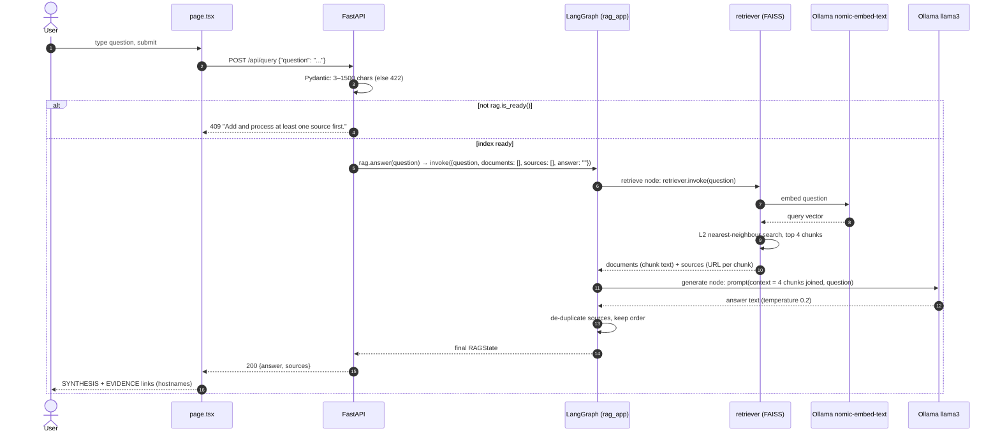

### 4.2 The LangGraph state machine

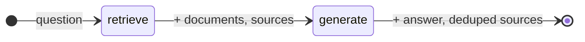

The graph state is a `TypedDict`:

```python
class RAGState(TypedDict):
    question: str        # set by the endpoint
    documents: List[str] # filled by retrieve: page_content of top-4 chunks
    sources: List[str]   # filled by retrieve: metadata["source"] per chunk
    answer: str          # filled by generate
```

Each node receives the full state and returns a new full state (`{**state, ...}`).

- **`retrieve`** raises if `_retriever` is `None` (a second guard behind the endpoint's 409 check), then runs the similarity search.
- **`generate`** builds the chain `prompt | llm | StrOutputParser()`, fills `{context}` with the four chunks separated by blank lines, and stores the plain-text answer. `dict.fromkeys(...)` removes duplicate URLs while keeping their order, because several of the top chunks often come from the same article.

The graph is linear today, but because it's a LangGraph `StateGraph`, adding steps (query rewriting, re-ranking, a "no answer" branch, tool calls) means adding nodes and edges rather than rewriting the endpoint.

### 4.3 The prompt

```
You are a precise financial research assistant. Answer only from the supplied
context. If the context does not support an answer, say so clearly. Keep the answer
concise and do not invent market data.

Context:
{context}        ← 4 retrieved chunks (≈ up to 4,000 characters)

Question: {question}

Answer:
```

The model only sees these four chunks, never the full articles, so answer quality depends heavily on retrieval. Errors in the graph (for example Ollama not running) return **500** `"Could not generate research: …"`.

### 4.4 Streaming variant (`POST /api/query/stream`), used by the dashboard

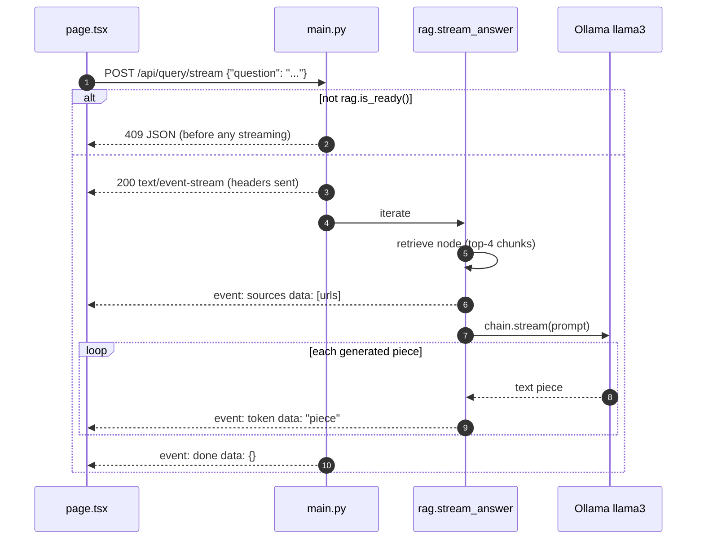

- Each event is `event: <name>\ndata: <json>\n\n`. JSON-encoding the data keeps newlines inside tokens from breaking the framing.
- The status is already 200 once streaming starts, so a failure mid-stream (for example Ollama stopping) is sent as `event: error` with `{"detail": "Could not generate research: …"}`.
- `stream_answer` reuses the `retrieve` node and the shared `chain` (`prompt | llm | StrOutputParser()`) but doesn't run the compiled graph, because it needs `chain.stream` rather than `invoke`. Any node added to the graph later must also be added here if it should apply to streamed answers.
- The handler is a sync generator, so Starlette runs it in a thread pool and the event loop stays free.
- `/api/query` (non-streaming JSON) is kept for scripts and other clients.

### 4.5 Web-search fallback, threads and gates (`backend/web_research.py`)

```mermaid
flowchart LR
    S[start_turn<br/>reset per-turn fields,<br/>summarize old turns] --> M[load_memories<br/>store search, first turn only] --> R[retrieve_scored<br/>FAISS top-4 + L2 distance] --> D[draft<br/>llama3 JSON: can_answer, answer]
    D -- "can_answer" --> FI[finish<br/>append AIMessage]
    D -- "not answerable" --> P[plan_search<br/>query, topic, time_range]
    P --> A[ask_permission<br/>interrupt: search gate]
    A -- "reject" --> U[unverified<br/>draft + not-verified note] --> FI
    A -- "approve / edit query" --> W[web_search<br/>cache or ONE Tavily call] --> F[final_answer<br/>cites URLs] --> RR[review_report<br/>interrupt: report gate]
    RR -- "approve / edit / reject" --> FI
    FI --> SM[save_memory<br/>preferences, companies, report summary] --> E([END])
```

- **One run = one turn.** The input is `{question, messages: [HumanMessage]}`. `messages` uses the `add_messages` reducer and persists across turns. `start_turn` clears the per-turn fields. Once `messages` exceeds `MAX_MESSAGES`, it summarizes the older ones into `summary` and removes them, keeping the last `KEEP_MESSAGES`. `draft_prompt` and `final_prompt` receive `{history}` (summary plus recent turns) and `{memories}`.
- **Gates.** Both gates use `interrupt()`. The payload has `kind: "web_search"` (with `draft` and the planned `search`) or `kind: "report"` (with `answer` and `sources`). Resume values go through `_decision`, which accepts the legacy bool from `/confirm` or `{action: approve|reject|edit, query?, draft?}`.
  - At the search gate, `edit` replaces `search.query` and implies approval.
  - At the report gate, `edit` replaces `answer`, and `reject` returns the unverified draft.
  - `plan_search` runs before the search gate so the query can be shown and edited. Planning costs no credits.
- **Deciding `can_answer`:** the LLM's JSON value, forced to `false` in three cases: the best FAISS distance is above `MAX_DISTANCE` (0.75), the question asks for recent or real-time info, or the draft admits it can't answer. If the JSON can't be parsed, the draft is treated as not answerable.
- **Credit safety:** there is no edge back to the search, `searches_used` is checked, failed searches aren't retried, and successful results are cached by (query, topic, time_range). The logs show `cache HIT (0 credits)` or `credit USED (1 credit)`.
- **Failures:** if Tavily fails (bad key, network, no results), the answer is the draft plus "Web search failed (…); answer not verified".
- **Streaming:** every run goes through `stream_run`, which calls `app.astream(…, stream_mode=["custom", "updates"], durability="sync")`. Nodes push events through LangGraph's stream writer:
  - `retrieve_scored` sends `sources`.
  - `draft` sends `token`s; the `"answer"` field is pulled out of the JSON as it streams.
  - `web_search` sends `status` events ("Searching the web: …", "Using cached web results", "Reading 5 web results…").
  - `final_answer` sends `token`s.

  After the stream, the thread head is read. A pending interrupt becomes `needs_confirmation`; otherwise the final state becomes `answered`. The JSON endpoints use the same generator (`run`).

### 4.6 Persistence, threads and memory

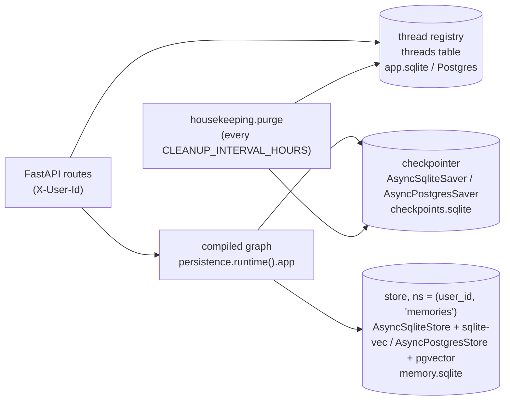

- **Choosing the backend.** `DATABASE_URL` is unset in dev, which means SQLite files in `backend/data/`. A `postgresql://…` URL switches the checkpointer, the store and the registry to Postgres. Everything is async (`astream`/`aget_state`), because `AsyncPostgresSaver` requires it. All of it is opened in the FastAPI `lifespan` and closed on shutdown, so no connection or client lives in graph state.
- **Durability.** Every run passes `durability="sync"`, so each superstep is written before the next one starts.
  - **Interrupts and restarts.** A paused thread survives a restart and is resumed with `Command(resume=…)`.
  - **Failed nodes.** When a node raises, the thread is marked `failed`. `POST /threads/{id}/retry` runs `astream(None, config)`, which re-runs only the unfinished node(s). A completed `web_search` is not paid for again.
  - **Crashes.** At startup, `threads.fail_running()` marks threads that were still `running` as `failed`, so they can be retried.
- **Ownership.** `config.configurable` carries `thread_id` and `user_id`. Every `/threads/{id}…` route and the legacy `/confirm` look the thread up in the registry by `(thread_id, user_id)`; a miss returns 404.
- **Time travel.**
  - `/history` uses `aget_state_history`.
  - `/replay` runs `astream(None, config + checkpoint_id)`, which forks from that checkpoint; the new branch becomes the head and old checkpoints are kept.
  - `/fork` calls `aupdate_state` at a past checkpoint with edited values (any state key except `messages`), then optionally runs the new branch.
- **Long-term memory.**
  - `load_memories` runs on the first turn of a thread and searches the user's namespace by the question (`MEMORY_SEARCH_LIMIT`).
  - `save_memory` runs after every completed turn. One JSON-mode call extracts `{preferences, companies, summary}`, which are upserted under the keys `pref:<hash>`, `company:<slug>` and `report:<thread>:<turn>`, so repeats overwrite rather than duplicate.
  - Both are best-effort: an error is logged and never fails the answer.
- **Cleanup.** Threads whose registry `updated_at` is older than `CHECKPOINT_TTL_DAYS` lose their checkpoints and registry row. Orphan checkpoint threads (no registry row, latest checkpoint past the TTL) are deleted too. Memories and the Tavily cache are kept.

### 4.7 Model provider (`backend/llm.py`)

`LLM_PROVIDER` (environment or `.env`) picks the models once, at import:

| | `ollama` (default, local) | `groq` (deployed server) |
|---|---|---|
| Text model (`rag.llm`) | `OllamaLLM(llama3)` | `ChatGroq(GROQ_MODEL)`, default `openai/gpt-oss-120b` with `reasoning_effort="low"` (Qwen models get `reasoning_format="hidden"`) |
| JSON model (`web_research.json_llm`) | `format="json"` | `response_format={"type": "json_object"}` (`GROQ_JSON_MODE=on\|off`; verified with streaming) |
| Embeddings (`rag.embeddings`, memory index) | `nomic-embed-text` (768) via Ollama | `HuggingFaceEmbeddings(BAAI/bge-small-en-v1.5)` (384, normalized), run locally on CPU with `sentence-transformers`; Groq has no embedding models |

- Every chain is `prompt | model | StrOutputParser()`, so the rest of the code doesn't know which provider runs. The tests patch the same module attributes.
- **Embeddings must match the index.** `build_index` writes `faiss_index/meta.json` (`{provider, model, dims}`). `load_saved_index` refuses an index built with another embedding model and reports why in `/health` (`index_problem`); create the collection again. An index without `meta.json` counts as Ollama `nomic-embed-text`. Long-term memories are embedded too, so a deployed Groq server should use its own database.
- **Separate data per provider.** `ollama` uses `backend/faiss_index/` and `backend/data/`; `groq` uses `backend/data/groq/` for the collection (`faiss_index/`), checkpoints, registry, memories and Tavily cache (`config.py`). `EMBED_DIMS` defaults to 768 or 384 to match. Switching locally never overwrites the other provider's collection or mixes memories.
- `MAX_DISTANCE` (0.75) suits both embedding models. On the Nvidia Wikipedia article, nomic scored 0.37–0.68 on-topic and 1.02–1.20 off-topic; bge-small scored 0.24–0.60 and 0.91–1.12. `retrieve_scored` logs the best distance of every question, for checking another model.
- `python -m backend.llm` makes one text, one JSON, one streamed JSON and one embedding call with the configured provider, to check the key and models.
- No LLM gateway (LiteLLM) is used. With two providers, LangChain is enough. A gateway becomes worth it for more providers, per-user budgets and rate limits, or shared key management.
- `/health` reports `llm` (e.g. `ollama:llama3`), shown in the dashboard nav.

---

## 5. Frontend internals (`frontend/app/`)

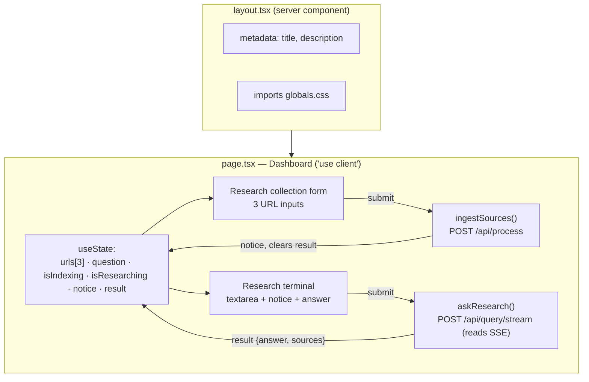

- **Client components.** The terminal logic is in `Dashboard` (`page.tsx`). The **Research threads** panel is `ThreadsPanel` (`threads.tsx`): it lists the user's threads and shows the open thread's conversation, recalled memories, retry/delete and checkpoint history with replay and fork. Shared fetch/SSE helpers and types are in `api.ts`. There are no API routes or server actions, and `layout.tsx` only sets metadata and global CSS. (The diagram above predates the threads panel.)
- **Threads in the UI.** With web fallback on, the terminal asks on `activeThread` via `/threads/{id}/messages/stream`. It creates a thread first if none is open, or if the open one is paused at a gate. Gates are answered via `/threads/{id}/resume/stream`. Selecting a thread loads its pending gate or last answer into the terminal. Every request sends `X-User-Id` from the panel's USER field (kept in `localStorage`).
- **API base URL** is `process.env.NEXT_PUBLIC_API_URL`, defaulting to `http://localhost:8000`. The browser calls FastAPI directly, which is why the backend needs CORS for `localhost:3000`.
- **UI state:**
  - `isIndexing` / `isResearching` disable the buttons and change their labels during requests.
  - `notice` is a single status line used for progress, success and error messages; on failure it shows the backend's `detail`.
  - `isStreaming` shows a blinking `.cursor` after the answer text while tokens are arriving.
  - `result` holds the current answer. It starts empty, sources fill in on the `sources` event, and each `token` event is appended. The answer paragraph uses `white-space: pre-wrap`, so the model's line breaks show. Sources render as links labelled by hostname (`new URL(source).hostname`, `www.` removed).
- **Static sections** (hero, "On the horizon" roadmap cards, footer) are presentational only.
- The UI shows three URL fields, while the API accepts up to ten.

---

## 6. Data on disk

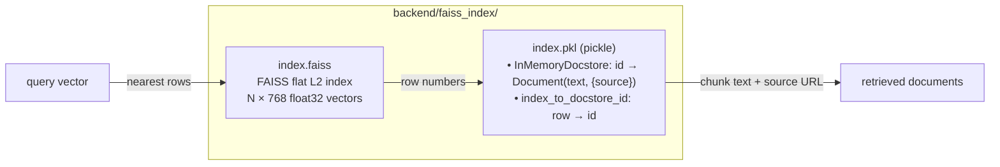

FAISS itself only stores numbers. LangChain keeps the mapping from each vector row to its chunk text and URL in `index.pkl`; both files are needed to answer a query.

**Versions.** Each collection is saved to its own directory `INDEX_PATH/v<time>-<pid>/` (`index.faiss`, `index.pkl`, `meta.json`), and the small file `INDEX_PATH/CURRENT` names the active one. `rag.publish()` writes the new directory first, then replaces `CURRENT` atomically (`os.replace`), and keeps the newest 3. Every request that touches the index (`is_ready`, `search_with_scores`, `retrieve`) reads `CURRENT` and reloads if it changed. So with several uvicorn workers, a collection built by one worker is used by all of them from their next request, and nobody reads a half-written index. A flat index from before versioning (files directly in `INDEX_PATH`) still loads.

---

## 7. Error handling and status codes

| Situation | Where caught | Status | Message shown in UI |
|---|---|---|---|
| Invalid URL / too many URLs / question too short or long | Pydantic models | 422 | FastAPI validation detail |
| Page fetch fails, page empty, embedding fails | `/api/process` `except` | 422 | `Could not process URLs: …` |
| Query before any collection exists | `/api/query` guard | 409 | `Add and process at least one source first.` |
| Ollama down or generation error | `/api/query` `except` | 500 | `Could not generate research: …` |
| Unknown thread, or another user's thread | `owned_thread` / `_owned_or_404` | 404 | `Unknown thread_id.` |
| Resume a thread that isn't paused; new question while paused or running; retry a non-failed thread | threads API guards | 409 | e.g. `This question is not waiting for confirmation.` |
| A graph node fails mid-run (e.g. Ollama down) | `tracked()` marks the thread `failed` | 500 / SSE `error` | `Could not answer: …` (then `/threads/{id}/retry`) |
| Two runs on one thread at once (double-clicked resume, two workers) | `threads.claim()` (atomic `UPDATE … WHERE status IN …`) | 409 | `This thread is already running.` |
| `Idempotency-Key` reused with a different body / while the first is running | `idempotency.run_once` | 422 / 409 | `This Idempotency-Key was already used for a different request.` |
| Database unreachable at startup | `db.wait_for_db` (prestart, lifespan, migrate) | process exits | `Cannot reach PostgreSQL (host=… db=… user=…) after 30s: …` (password masked) |
| Schema not migrated | `threads.open_registry` | process exits | `Run the migrations first: docker compose run --rm migrate` |
| API not running | browser `fetch` throws | — | `Could not reach the research API.` |

`GET /health` returns `{"status": "ok"|"degraded", "db": "ok"|"error: …", "collection_ready": <bool>, "index_problem": <str|null>, "persistence": "sqlite"|"postgres", "llm": "<provider>:<model>"}`. It pings the registry engine and, on Postgres, the LangGraph pool (2 s timeout each): **200** when the database answers, **503** otherwise. The Docker `HEALTHCHECK` uses it. No collection yet is still healthy.

---

## 8. Design trade-offs and limits

- **Single collection.** Each `/api/process` call replaces the index; there are no collections per user or topic.
- **No authentication.** `X-User-Id` is trusted. Threads and memories are scoped per user, but anyone who can reach the API can claim any user ID.
- **One API replica.** Several uvicorn workers in one container are safe (claims, index versions, advisory-locked cleanup, `fail_running` once per container start). Several API *containers* would also need `fail_running` to know which container owned a run; it currently assumes a container restart means every `running` thread died.
- **Streaming, but not cancellable.** The dashboard streams tokens as `llama3` writes them, but there is no stop button. Closing the page doesn't necessarily stop generation on the server right away.
- **Exact search.** Flat L2 search is accurate and fast at this scale; a large corpus would need an approximate FAISS index (IVF/HNSW).
- **Fixed retrieval.** `k=4`, 1000-character chunks and temperature 0.2 are constants in `backend/config.py` (no env-var or per-request overrides).
- **Prompt-only grounding.** The prompt tells the model to answer only from the context and not invent market data, but nothing enforces it; `llama3` can still add outside knowledge when retrieved chunks are off-topic.
- **Local-only index.** `backend/faiss_index/` is git-ignored, so a fresh clone starts with no collection until URLs are processed.

---

## 9. Production deployment (Docker + PostgreSQL)

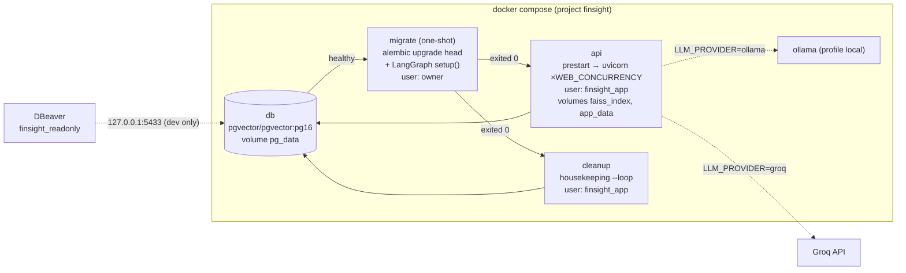

- **Image** (`Dockerfile`): a multi-stage build on `python:3.11-slim`. The builder installs CPU-only torch, then `backend/requirements.txt` pinned by `backend/constraints.txt`, and downloads `BAAI/bge-small-en-v1.5`. The runtime stage copies the venv and model cache, runs as uid 10001, has `HF_HUB_OFFLINE=1`, and a `HEALTHCHECK` on `/health`. No `.env` or secrets are in the build context (`.dockerignore`). The `test` stage adds pytest and `tests/`.
- **Roles** (`docker/db/init/01-roles.sh`, first init only; re-run with `scripts/db-roles.sh`):
  - The owner (`POSTGRES_USER`) is used only by `migrate`, backups and restores.
  - `finsight_app` gets SELECT/INSERT/UPDATE/DELETE through default privileges, and no DDL.
  - `finsight_readonly` gets SELECT only and `default_transaction_read_only`.
- **Startup order:** `db` healthy → `migrate` exits 0 → `api` and `cleanup`.
  - `api` runs `backend/prestart.py` once: wait for the DB, check the schema is at head, `fail_running()`. Then the workers start with `DB_SETUP_ON_START=false` and `FAIL_RUNNING_ON_START=false`.
  - Each worker opens one psycopg pool (`DB_POOL_MAX`) for the saver and store, plus a small SQLAlchemy pool for the registry.
- **Overrides:**
  - `docker-compose.override.yml` (dev, automatic): `./backend` mounted, `--reload` (polling), Postgres on `127.0.0.1:5433`.
  - `docker-compose.prod.yml`: no DB port, `WEB_CONCURRENCY=2`, `restart: always`, larger limits.
  - `docker-compose.e2e.yml`: the test stack on port 8100 with the fake-model app.
- **Operations:**
  - `scripts/backup.sh` writes a custom-format `pg_dump` to `backups/`, checks it, and keeps 14.
  - `scripts/restore.sh` stops the writers, recreates the DB, restores, re-grants, migrates, restarts and waits for `/health`.
  - The `cleanup` service purges every `CLEANUP_INTERVAL_HOURS` under an advisory lock.
- **Tables:** see [DATABASE.md](DATABASE.md) for every table, DBeaver access and inspection queries.

---

## 10. Supporting pieces (not in the runtime path)

| Path | Purpose |
|---|---|
| `notebooks/rag.ipynb` | Original prototype of the same pipeline in a notebook. Uses `UnstructuredURLLoader` and `llama3` at temperature 0.9, and writes its own `notebooks/faiss_index/`. Not imported by the app. |
| `Presentation/` | College deck (`FinSight_College_Presentation.pptx`), the script that generates it (`generate_deck.py`) and an image. |
| `docs/postcleanup.md` | Record of removed/moved files and known issues. |
| `CLAUDE.md` | Guidance for Claude Code working in this repo. |

---

## 11. Run-time lifecycle summary

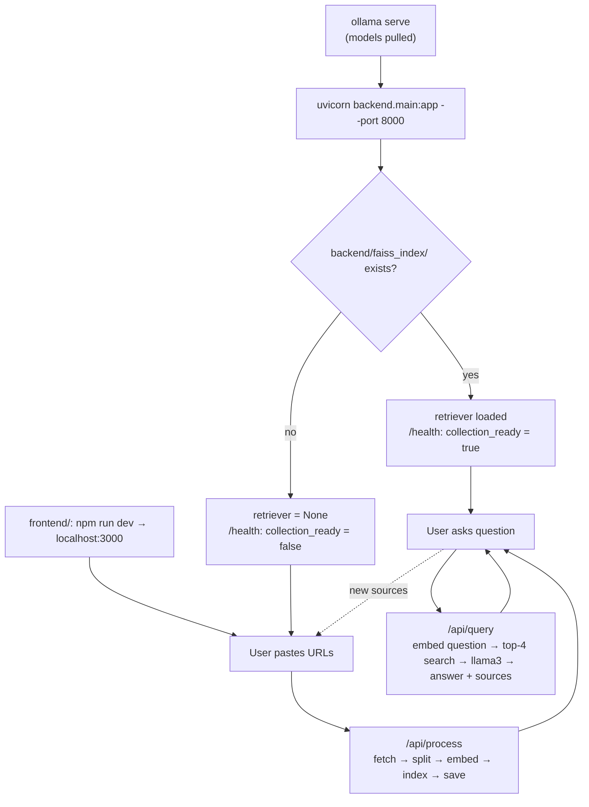
